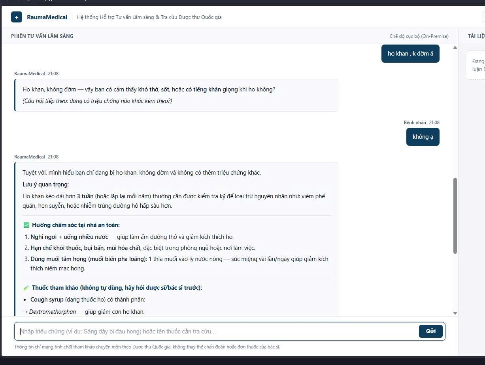
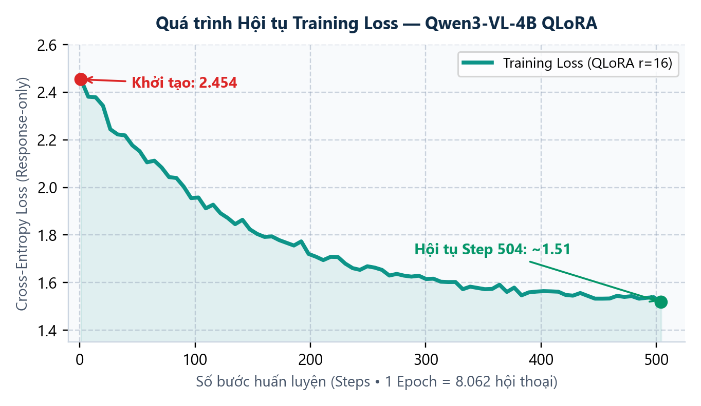
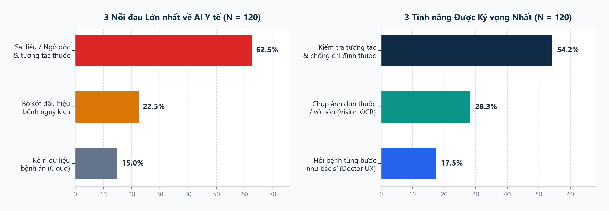
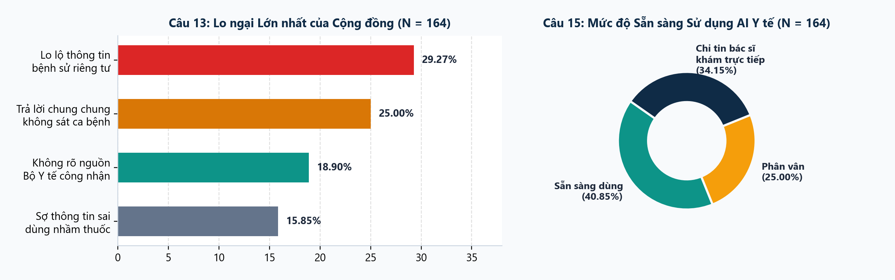

# NorMedical

**Hệ thống Hỗ trợ Tư vấn Lâm sàng Đa lượt & Tra cứu Dược thư Quốc gia Việt Nam vận hành Cục bộ (On-Premise)**

<p>
  <a href="https://huggingface.co/imdlam/q3medical"></a>
  <a href="https://huggingface.co/unsloth/Qwen3-VL-4B-Instruct-unsloth-bnb-4bit"></a>
  <a href="https://huggingface.co/imdlam/q3medical"></a>
  <a href="#6-hướng-dẫn-cài-đặt--khởi-chạy"></a>
  <a href="#3-kho-tri-thức--cơ-chế-truy-xuất-rag"></a>
</p>

---

## Điều hướng Nhanh

| Nghiên cứu & Mô hình | Kiến trúc & Triển khai |
| :--- | :--- |
| [01. Tổng quan & Hình ảnh Demo](#1-tổng-quan) | [06. Hướng dẫn Cài đặt & Khởi chạy](#6-hướng-dẫn-cài-đặt--khởi-chạy) |
| [02. Khảo sát Thực tế (`N=120` & `N=164`)](#2-cơ-sở-nghiên-cứu--khảo-sát-thực-tế) | [07. Tham chiếu Cấu hình & API Reference](#7-tham-chiếu-cấu-hình--api-reference) |
| [03. Kho Tri thức & Công thức BM25 RAG](#3-kho-tri-thức--cơ-chế-truy-xuất-rag) | [08. Kịch bản Thực nghiệm & Bộ Kiểm thử](#8-kịch-bản-thực-nghiệm--bộ-kiểm-thử) |
| [04. Huấn luyện QLoRA & Tối ưu Suy luận](#4-huấn-luyện-mô-hình--tối-ưu-suy-luận) | [09. Giới hạn Hiện tại & Lộ trình Phát triển](#9-giới-hạn-hiện-tại--lộ-trình-phát-triển) |
| [05. Kiến trúc Hệ thống & Cấu trúc Mã nguồn](#5-kiến-trúc-hệ-thống--cấu-trúc-mã-nguồn) | [10. Tài liệu Tham khảo & Miễn trừ Y khoa](#10-tài-liệu-tham-khảo--miễn-trừ-y-khoa) |

---

## 1. Tổng quan

**NorMedical** (tên trợ lý: **RaumaMedical**) là hệ thống hỗ trợ tư vấn sức khỏe sơ bộ, sàng lọc triệu chứng đa lượt và tra cứu dược lý tiếng Việt chạy hoàn toàn cục bộ trên phần cứng phổ thông (**GPU 4GB VRAM**). Dự án được xây dựng nhằm giải quyết bốn điểm nghẽn cốt lõi của các hệ thống hỏi đáp y tế hiện hành:

1. **Khắc phục tình trạng chẩn đoán vội vàng trong một lượt:** Thay vì nhận một câu mô tả ngắn rồi liệt kê tràn lan bệnh nặng hoặc trả lời chung chung, hệ thống chủ động hỏi khai thác từng câu một (tính chất, thời gian khởi phát, triệu chứng kèm theo, yếu tố kích phát) giống quy trình hỏi bệnh lâm sàng.
2. **Giảm thiểu ảo giác dược lý (Drug Hallucination):** Mọi truy vấn liên quan tới thuốc đều được đối chiếu trực tiếp với **1.754 chuyên luận Dược thư Quốc gia Việt Nam** và **673 bài Bệnh học Vinmec**, hiển thị song song nguyên văn trích đoạn đối chứng ngay trên giao diện.
3. **Vận hành cục bộ 100% (On-Premise Privacy):** Toàn bộ quá trình truy xuất RAG và suy luận mô hình ngôn ngữ lớn diễn ra trên máy tính cá nhân/nhà thuốc qua **LM Studio** và **FastAPI**, không gửi lịch sử bệnh án lên máy chủ đám mây.
4. **Kiểm soát an toàn lâm sàng chủ động:** Tự động phân luồng cảnh báo cấp cứu 115 đối với dấu hiệu cờ đỏ, chuẩn hóa lỗi gõ thiếu dấu tiếng Việt và tự động gắn tuyên bố miễn trừ trách nhiệm y khoa ở các lượt có tư vấn thuốc hoặc hướng xử trí.

### Hình ảnh Demo & Đường cong Huấn luyện

| Giao diện Cổng Tư vấn Lâm sàng (Web FastAPI) | Đường cong Hội tụ Huấn luyện (QLoRA `504 steps`) |
| :---: | :---: |
|  |  |

---

## 2. Cơ sở Nghiên cứu & Khảo sát Thực tế

Toàn bộ yêu cầu tính năng và kiến trúc kỹ thuật của hệ thống được thiết kế trực tiếp từ kết quả khảo sát thực địa trên hai nhóm mẫu độc lập:

### 2.1. Khảo sát Chuyên sâu (`N = 120`)
*Cơ cấu mẫu: 70% người dân • 20% sinh viên Y-Dược • 10% Bác sĩ & Dược sĩ đang công tác.*

| Chỉ tiêu Khảo sát | Tỷ lệ | Tác động đến Thiết kế Hệ thống |
| :--- | :---: | :--- |
| Tự tra cứu triệu chứng & tên thuốc trên mạng trước khi đi khám | **81.7%** | Xác nhận nhu cầu thực tế cao cho công cụ sàng lọc ban đầu |
| Đã từng dùng AI tổng quát nhưng chỉ thực sự hài lòng về độ tin cậy | **68.3%** / **23.3%** | Cần tinh chỉnh mô hình chuyên biệt cho bối cảnh y tế Việt Nam |
| Yêu cầu công cụ dẫn nguồn chính thống từ cơ quan y tế trong nước | **94.2%** | Tích hợp trực tiếp Dược thư Quốc gia và hiển thị nguồn đối chứng |
| Lo ngại AI sai liều dẫn tới ngộ độc hoặc tương tác thuốc nguy hiểm | **62.5%** | Bắt buộc trích xuất đầy đủ liều dùng & chống chỉ định từ Dược thư |
| Sợ AI bỏ sót dấu hiệu bệnh nặng, lỡ thời gian vàng cấp cứu | **22.5%** | Tích hợp bộ định tuyến Cờ đỏ cấp cứu (Red Flag Alert 115) |
| Kỳ vọng thời gian phản hồi dưới 5 giây (`< 3s`: 38.3%, `3-5s`: 45.0%) | **76.7%** | Triển khai truyền dòng Streaming SSE kèm trạng thái `Thinking...` |

### 2.2. Khảo sát Cộng đồng Độc lập (`N = 164`, Thang Likert 1–5)
- **Điểm đánh giá hiện trạng AI y tế nói chung:** Tốc độ phản hồi `3.09` (SD `1.45`), Cách diễn đạt dễ hiểu `2.93` (SD `1.39`), Mức độ chi tiết `3.05` (SD `1.47`), Giúp yên tâm & biết hướng xử lý `3.10` (SD `1.39`), Hài lòng tổng thể `3.21` (SD `1.35`).
- **4 lo ngại lớn nhất của cộng đồng:** Lộ thông tin bệnh sử riêng tư (**29.27%**), câu trả lời chung chung không sát ca bệnh (**25.00%**), không rõ nguồn Bộ Y tế công nhận (**18.90%**), sợ thông tin sai dẫn tới dùng nhầm thuốc (**15.85%**).
- **Mức độ sẵn sàng sử dụng:** **40.85%** sẵn sàng sử dụng (trong đó 26.83% dùng để tham khảo thêm), **25.00%** phân vân, **34.15%** chỉ tin tưởng tuyệt đối khi bác sĩ khám trực tiếp.

| Phân tích Nỗi đau & Kỳ vọng (`N = 120`) | Lo ngại & Mức độ Sẵn sàng (`N = 164`) |
| :---: | :---: |
|  |  |

---

## 3. Kho Tri thức & Cơ chế Truy xuất RAG

Hệ thống sử dụng bộ truy xuất **BM25 tùy biến** chạy hoàn toàn trên RAM CPU (thời gian truy vấn `< 10 ms`, tiêu thụ `0 MB` VRAM GPU) trên **2.427 tài liệu y dược chuẩn hóa**:

| Nguồn Dữ liệu | Tệp Lưu trữ | Quy mô | Trường Thông tin Chuẩn hóa |
| :--- | :--- | :---: | :--- |
| **Dược thư Quốc gia Việt Nam** | `src/rag/data/drugs_knowledge_base.jsonl` | `1.754` chuyên luận | Hoạt chất, mã ATC, nhóm dược lý, dạng bào chế, chỉ định, liều dùng, chống chỉ định, thận trọng, ADR, tương tác |
| **Bệnh học Lâm sàng Vinmec** | `src/rag/data/diseases_knowledge_base.jsonl` | `673` bài bệnh học | Tên bệnh, nguyên nhân, triệu chứng điển hình, hướng theo dõi & xử trí |

### Cơ chế Tính điểm & Chống nhiễu của `BM25MedicalRetriever`
1. **Tokenization lai (Unigram + Bigram):** Tách từ tiếng Việt kết hợp cụm 2 từ liền kề (`bigrams`), giúp khớp chính xác các cụm y khoa như `đau_họng`, `tiêu_chảy`, `trào_ngược`.
2. **Thưởng điểm khớp tiêu đề & tiền tố hoạt chất ASCII:** Cộng `+35.0` khi tên hoạt chất/bệnh xuất hiện nguyên văn trong câu hỏi; cộng `+25.0` khi khớp tiền tố hoạt chất tiếng Anh (`>= 6` ký tự, sai lệch độ dài `<= 2`, ví dụ `omeprazol` khớp `Omeprazole`); cộng `+20.0` khi khớp bigram tiêu đề.
3. **Mở rộng từ đồng nghĩa triệu chứng & biệt dược (`symptom_drug_synonyms`):** Ánh xạ tự động triệu chứng đời thường và tên thương mại phổ biến sang tên hoạt chất chuẩn trong Dược thư (`Panadol / Efferalgan / Hapacol -> Paracetamol`, `Smecta -> Diosmectit`, `Oresol -> ORS`, `Gaviscon / Phosphalugel -> Omeprazole / Esomeprazole`, `ho -> Dextromethorphan / Acetylcystein / Guaifenesin`).
4. **Lọc nhiễu & ưu tiên chuyên luận giàu dữ liệu:**
   - Loại bỏ từ dừng y tế (`query_stopwords`) và danh sách từ đời thường trùng tên hoạt chất (`common_false_drugs`: *nước, muối, đường, sắt, kẽm, dầu, rượu, mật ong, gừng, tỏi, chanh...*).
   - Giảm trọng số (`* 0.45`) đối với các mục còn thiếu chi tiết trong Dược thư để luôn ưu tiên chuyên luận đầy đủ liều dùng và chống chỉ định.
   - Khi đang ở chế độ tra cứu thuốc thuần túy, đặt `top_k_diseases = 0` để tránh kéo nhầm bài bệnh lý nặng gây hoang mang không cần thiết.

---

## 4. Huấn luyện Mô hình & Tối ưu Suy luận

### 4.1. Tiền xử lý & Làm sạch Dữ liệu Huấn luyện
Phân tích tập dữ liệu mở `ViHealthQA` cho thấy câu hỏi thô có độ dài trung vị chỉ `63` ký tự (dạng tiêu đề bài viết bị cắt), trong khi câu trả lời thường nhắc tới bệnh án ẩn (*"bé 6.5 tháng"*, *"vợ em"*) hoặc lặp lại văn mẫu khuyên đi khám một chuyên khoa cố định. Quy trình làm sạch đa nguồn (`ViHealthQA`, `Vinmec`, `BookingCare`, `Medical-o1-reasoning-vi`) đã tạo ra:

- **Tập SFT Đơn lượt sạch:** `7.439` mẫu huấn luyện (`train_sft_clean.csv`) + `500` mẫu kiểm định (`val_sft_clean.csv`).
- **Tập Hội thoại Đa lượt (Multi-turn SFT):** `8.063` hội thoại đơn và đa lượt (`train_sft_multiturn_messages.jsonl`).

### 4.2. Thông số Huấn luyện QLoRA & Hồ sơ Phần cứng

| Hạng mục | Thông số Thực tế |
| :--- | :--- |
| **Mô hình nền (Base Model)** | `unsloth/Qwen3-VL-4B-Instruct-unsloth-bnb-4bit` |
| **Kho trọng số công khai** | [huggingface.co/imdlam/q3medical](https://huggingface.co/imdlam/q3medical) |
| **Môi trường & Kỹ thuật** | QLoRA 4-bit (Unsloth) trên GPU Tesla T4 (15GB VRAM) |
| **Tham số LoRA** | `r = 16`, `lora_alpha = 16`, `lora_dropout = 0.05`, `bias = "none"` |
| **Phạm vi lớp tinh chỉnh** | `finetune_language_layers = True`, đóng băng nhánh Vision (`finetune_vision_layers = False`) |
| **Loss Masking** | `train_on_responses_only` (chỉ tính hàm mất mát trên phần phản hồi `<\|im_start\|>assistant`) |
| **Lịch học & Số bước** | `learning_rate = 3e-5`, `cosine` scheduler, `504 steps` (1 epoch / 8.062 hội thoại) |
| **Độ hội tụ Training Loss** | Giảm đều từ **`2.454`** xuống **`~1.51 - 1.55`** |
| **Dung lượng Trọng số LoRA** | `132 MB` (`adapter_model.safetensors`, tổng 7 tệp cấu hình ~`137 MB`) |
| **Triển khai Cục bộ (Local)** | GGUF `Q4_K_M` (~`2.4 - 3.2 GB VRAM`), vận hành mượt trên Laptop **RTX 3050 (4GB VRAM)** |

### 4.3. Các Phát hiện Kỹ thuật khi Tối ưu Suy luận (Inference Engineering)
1. **Hiệu chỉnh hệ số `LoRA Scaling = 0.25`:** Ở mức mặc định `scaling = 1.0`, trọng số LoRA rank-16 có xu hướng lấn át khả năng suy luận sinh lý bệnh gốc của mô hình nền (*Catastrophic Forgetting*). Việc giảm hệ số về `0.25` bảo toàn trọn vẹn tư duy lâm sàng của `Qwen3-4B` trong khi vẫn giữ văn phong y khoa tiếng Việt tự nhiên.
2. **Tối ưu bộ giải mã (Decoding) cho Tiếng Việt:** Loại bỏ tham số `no_repeat_ngram_size = 4` vì trên tokenizer tiếng Việt (tách theo âm tiết), cơ chế cấm 4-gram làm biến dạng dấu và từ ghép (*"uể oải" -> "uể oại"*, *"RaumaMedical" -> "RaumaMedial"*). Bộ tham số tối ưu thực nghiệm: `temperature = 0.30`, `top_p = 0.88`, `top_k = 40`, `repeat_penalty = 1.12`, `presence_penalty = 0.35`, `frequency_penalty = 0.25`, `max_tokens = 750`.
3. **Tách biệt System Prompt theo Luồng Nghiệp vụ:** Tách riêng `system_drug_lookup` (cho tra cứu thuốc) và `system_clinical` (cho hỏi bệnh đa lượt), kết hợp nâng giới hạn trích đoạn RAG lên `1.500` ký tự/chuyên luận để đảm bảo mô hình đọc trọn vẹn mục *Liều lượng & Cách dùng* và *Chống chỉ định*.

---

## 5. Kiến trúc Hệ thống & Cấu trúc Mã nguồn

### Sơ đồ Luồng Xử lý 4 Chế độ Lâm sàng

```text
  [Người dùng]
       │
       ▼
  VietnameseMedicalNormalizer
       ├── Chuẩn hóa lỗi chính tả thiếu dấu ("nước đa" -> "nước đá", "đau học" -> "đau họng")
       └── Phân loại ý định (Chào hỏi / Cờ đỏ / Tra cứu thuốc / Xác nhận ngắn / Triệu chứng)
       │
       ▼
  ConsultationService (Bộ định tuyến 4 chế độ)
       ├──► 1. Cờ đỏ Cấp cứu      ──► Cảnh báo gọi 115 & hướng dẫn sơ cứu an toàn tức thì
       ├──► 2. Tra cứu Dược lý    ──► Mở rộng từ khóa -> BM25 RAG (Top 3 Dược thư) -> system_drug_lookup
       ├──► 3. Khai thác Đa lượt  ──► Hỏi cuốn chiếu 1 câu/lượt (tính chất -> triệu chứng kèm -> bối cảnh)
       └──► 4. Kết luận Tư vấn    ──► Dừng hỏi khi đủ dữ kiện / phủ định ngắn -> Tổng hợp 3 phần + Miễn trừ y khoa
       │
       ▼
  LMStudioSSEClient (OpenAI-compatible SSE Streaming) ──► FastAPI Web (:8386) / Terminal CLI
```

### Cấu trúc Thư mục

```text
NorMedical/
├── assets/img/                     # Ảnh chụp giao diện demo & 3 biểu đồ thực nghiệm/khảo sát
├── config.json                     # Cấu hình tập trung: API, decoding, RAG, prompts, từ điển chuẩn hóa
├── keys.example.json               # Tệp mẫu khóa truy cập (copy thành keys.json khi triển khai)
├── requirements.txt                # Danh sách thư viện Python phụ thuộc
├── main.py                         # Điểm khởi chạy CLI & Gradio
├── web/
│   ├── app.py                      # Máy chủ FastAPI SSE Streaming (cổng mặc định 8386)
│   └── static/
│       └── index.html              # Giao diện cổng tư vấn lâm sàng 2 cột (Markdown renderer offline)
├── src/
│   ├── config/settings.py          # Nạp cấu hình dạng frozen dataclass & tự động chuẩn hóa đường dẫn
│   ├── domain/
│   │   ├── models.py               # KnowledgeDocument, ChatMessage, ConsultationTurn
│   │   └── interfaces.py           # Giao diện trừu tượng: ITextNormalizer, IRagRetriever, ILLMClient
│   ├── preprocessing/normalizer.py # Chuẩn hóa tiếng Việt, phân loại ý định & mở rộng từ khóa thuốc
│   ├── rag/
│   │   ├── bm25_retriever.py       # Bộ lập chỉ mục & truy xuất BM25 + Bigram + tiền tố ASCII
│   │   └── data/                   # Kho tri thức Dược thư Quốc gia & Bệnh học Vinmec (.jsonl)
│   ├── llm/lmstudio_client.py      # Client truyền dòng SSE chuẩn OpenAI API
│   ├── services/consultation_service.py # Điều phối hội thoại đa lượt, định tuyến 4 chế độ & gắn miễn trừ
│   └── ui/                         # Giao diện dòng lệnh CLI & Gradio
└── tests/
    └── test_edge_cases.py          # Bộ kiểm thử tự động 12 tình huống đặc biệt
```

---

## 6. Hướng dẫn Cài đặt & Khởi chạy

### Bước 1: Clone mã nguồn và cài đặt thư viện
```bash
git clone https://github.com/im-dlam/NorMedical.git
cd NorMedical
pip install -r requirements.txt
```

### Bước 2: Khởi tạo tệp khóa bảo mật
```bash
cp keys.example.json keys.json
```
*(Tệp `keys.json` đã được đưa vào `.gitignore` để không lộ khóa API lên kho mã nguồn.)*

### Bước 3: Tải mô hình từ Hugging Face & Bật LM Studio Local Server
- **Kho mô hình:** https://huggingface.co/imdlam/q3medical

1. Mở **LM Studio**, vào mục tìm kiếm (**Discover / Search**) và tìm `imdlam/q3medical`, sau đó tải bản lượng tử hóa **GGUF (`Q4_K_M`)** và chọn nạp mô hình.
2. *(Tùy chọn tải thủ công bằng CLI):*
   ```bash
   pip install huggingface_hub
   huggingface-cli download imdlam/q3medical --local-dir ./models/q3medical
   ```
3. Đặt **Context Length = `4096`** trong LM Studio để đủ bộ nhớ cho các chuyên luận Dược thư.
4. Chuyển sang mục **Developer (`<-->`)** và bật **Start Server** (cổng mặc định `http://localhost:1234/v1/chat/completions`).

### Bước 4: Khởi chạy Hệ thống

- **Giao diện Web FastAPI (Khuyến nghị — Cổng mặc định `8386`):**
  ```bash
  cd web
  uvicorn app:app --port 8386
  ```
  Truy cập trình duyệt tại: `http://127.0.0.1:8386`

- **Giao diện Dòng lệnh (CLI Streaming):**
  ```bash
  python main.py --mode cli
  ```
  *(Gõ `reset` để làm mới phiên khám, `exit` để thoát.)*

---

## 7. Tham chiếu Cấu hình & API Reference

### 7.1. Cấu trúc tệp `config.json`

| Nhóm Cấu hình | Vai trò chính |
| :--- | :--- |
| `app` | Tên hệ thống, phiên bản và số lượng tin nhắn lịch sử giữ lại (`max_history_turns = 6`) |
| `api` | Địa chỉ máy chủ suy luận (`base_url`), tên model, `timeout_seconds` và cờ `stream: true` |
| `decoding` | Tham số sinh văn bản (`temperature`, `top_p`, `top_k`, `repeat_penalty`, `presence_penalty`, `frequency_penalty`, `max_tokens`) |
| `rag` | Đường dẫn 2 tệp `.jsonl`, ngưỡng điểm `min_score_threshold = 12.0`, `top_k_drugs = 3`, `max_snippet_chars = 1500` |
| `prompts` | Câu chào (`greeting`), `medical_disclaimer`, `system_drug_lookup`, `system_clinical` |
| `nlp` | Bảng sửa lỗi gõ (`typo_map`), `common_false_drugs`, `query_stopwords`, `red_flag_keywords`, `symptom_drug_synonyms` |

### 7.2. FastAPI Endpoints (`web/app.py`, cổng `8386`)

| Method | Endpoint | Mô tả |
| :---: | :--- | :--- |
| `GET` | `/` | Phục vụ giao diện cổng tư vấn lâm sàng 2 cột (render Markdown offline, trạng thái `Thinking...`) |
| `GET` | `/api/health` | Trả về JSON gồm `status`, `knowledge_count` (`2427`) và `lm_studio_url` |
| `POST` | `/api/chat` | Nhận `{"message": "..."}`, trả về luồng **SSE** gồm các sự kiện `rag`, `token`, `error`, `done` |
| `POST` | `/api/reset` | Xóa lịch sử hội thoại để khởi tạo phiên khám mới |

---

## 8. Kịch bản Thực nghiệm & Bộ Kiểm thử

### 8.1. Minh họa Hội thoại Lâm sàng Đa lượt (5 Lượt thực tế)
1. **Lượt 1:** `"bạn là ai"` -> Giới thiệu danh tính **RaumaMedical**, mời người bệnh mô tả triệu chứng.
2. **Lượt 2:** `"Hôm nay ngủ dậy tôi thấy uể oải thì bị sao"` -> Không kết luận vội; đặt câu hỏi khai thác về độ tuổi, thời gian xuất hiện và chất lượng giấc ngủ.
3. **Lượt 3:** `"Tôi 18 tuổi, ngủ dậy là uể oải, bị 3 ngày nay rồi"` -> Ghi nhận dữ kiện, hỏi thêm về thời lượng ngủ và các triệu chứng đi kèm.
4. **Lượt 4:** `"Ngủ 6h, kh kèm gì khác"` -> Phân tích nhóm nguyên nhân thiếu ngủ/rối loạn nhịp sinh học ở tuổi 18 và hướng dẫn điều chỉnh sinh hoạt.
5. **Lượt 5:** `"không cân, giờ tôi TÔi thấy đau học"` -> Tự động chuẩn hóa lỗi chính tả `"đau học" -> "đau họng"`, tổng hợp toàn bộ 3 dữ kiện (18 tuổi + uể oải 3 ngày + đau họng mới khởi phát) để định hướng nhóm viêm đường hô hấp trên và nêu dấu hiệu cần đi khám.

### 8.2. Kiểm thử Tự động
Chạy bộ kiểm thử tích hợp sẵn:
```bash
python tests/test_edge_cases.py
```

- **Bộ kiểm thử 12 tình huống đặc biệt (`tests/test_edge_cases.py`):** **12/12 PASS** — kiểm chứng tra cứu thuốc theo triệu chứng, tên hoạt chất, dấu hiệu cờ đỏ cấp cứu 115, chuẩn hóa lỗi thiếu dấu (`nước đa -> nước đá`, `đau học -> đau họng`) và chống lặp vòng câu hỏi ở mô hình 4B.
- **Kiểm định truy xuất RAG trên 20 câu hỏi thuốc thực tế** *(ho, ho khan, ho có đờm, đau đầu, sốt cao, đau răng, đau dạ dày, trào ngược ợ chua, nghẹt mũi, buồn nôn, viêm họng, dị ứng ngứa, tiêu chảy, Paracetamol, Panadol, Ibuprofen, Amoxicillin, Omeprazole, Oresol, Berberin, Smecta)*: Đạt **20/20** trích xuất trúng chuyên luận Dược thư Quốc gia.

---

## 9. Giới hạn Hiện tại & Lộ trình Phát triển

### Giới hạn hiện tại
- **Quy mô mô hình nhỏ (`4B` nén 4-bit):** Với các ca bệnh đa bệnh nền phức tạp hoặc cần suy luận dược động học sâu, độ sâu suy luận còn giới hạn so với các mô hình lớn (`32B - 70B`).
- **Độ phủ biệt dược thương mại:** Kho thuốc hiện phủ `1.754` hoạt chất gốc Dược thư Quốc gia và nhóm biệt dược thông dụng, chưa bao phủ toàn bộ danh mục số đăng ký biệt dược lưu hành.
- **Tính liều độc lập & ngữ nghĩa dài:** Chưa có module Python tính liều cứng theo cân nặng (kg) hoặc tìm kiếm lai vector cho mô tả dân dã dài.

### Lộ trình nâng cấp
- **Ngắn hạn (P0):** Bổ sung tìm kiếm lai Hybrid Search (`BM25 + FAISS Vector`) và chạy bộ đánh giá định lượng tự động (`BERTScore`, `ROUGE-L`, `Faithfulness`) trên tập kiểm định độc lập `val_sft_clean.csv` (`500` mẫu).
- **Trung hạn (P1):** Tích hợp danh mục biệt dược Bộ Y tế (DAV) + `RapidFuzz`, xây dựng module Python kiểm tra tương tác đa thuốc & tính liều theo cân nặng (kg), kích hoạt nhánh Thị giác của `Qwen3-VL` cho bài toán OCR đơn thuốc / vỏ hộp.
- **Dài hạn (P2):** Đóng gói triển khai 1-Click / Docker, hỗ trợ nhập liệu giọng nói tiếng Việt và thẩm định mù cùng đội ngũ Bác sĩ/Dược sĩ chuyên khoa.

---

## 10. Tài liệu Tham khảo & Miễn trừ Y khoa

### Tài liệu Tham khảo
- Bộ Y tế Việt Nam (2022). *Dược thư Quốc gia Việt Nam lần xuất bản thứ ba*. Nhà xuất bản Y học, Hà Nội.
- Hệ thống Y tế Vinmec. *Cẩm nang Bệnh học Lâm sàng*.
- Qwen Team, Alibaba Cloud (2025). *Qwen3 & Qwen3-VL Technical Report*.
- Dettmers, T. et al. (NeurIPS 2023). *QLoRA: Efficient Finetuning of Quantized LLMs*.
- Hu, E. J. et al. (ICLR 2022). *LoRA: Low-Rank Adaptation of Large Language Models*.
- Lewis, P. et al. (NeurIPS 2020). *Retrieval-Augmented Generation for Knowledge-Intensive NLP Tasks*.
- Robertson, S., & Zaragoza, H. (2009). *The Probabilistic Relevance Framework: BM25 and Beyond*.

### Miễn trừ Trách nhiệm Y khoa
> Hệ thống **NorMedical** được phát triển cho mục đích nghiên cứu học thuật và hỗ trợ tra cứu thông tin tham khảo theo Dược thư Quốc gia Việt Nam. Mọi phản hồi từ hệ thống **không phải là đơn thuốc** và không thay thế cho việc thăm khám, chẩn đoán hoặc chỉ định điều trị trực tiếp của bác sĩ chuyên khoa.
